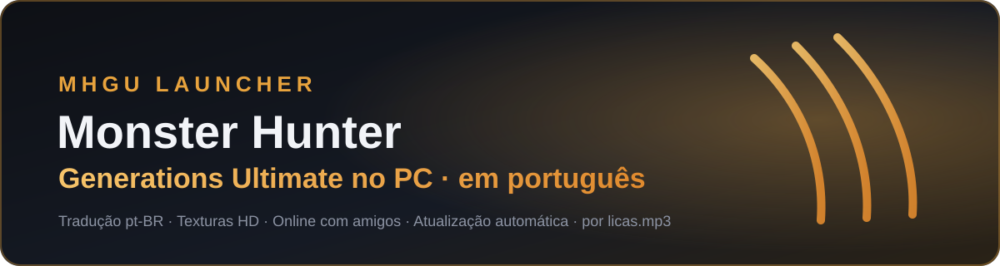
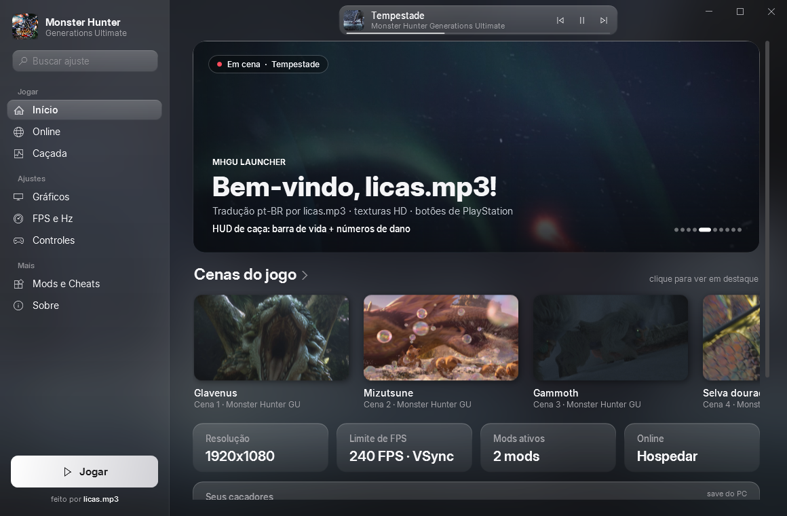
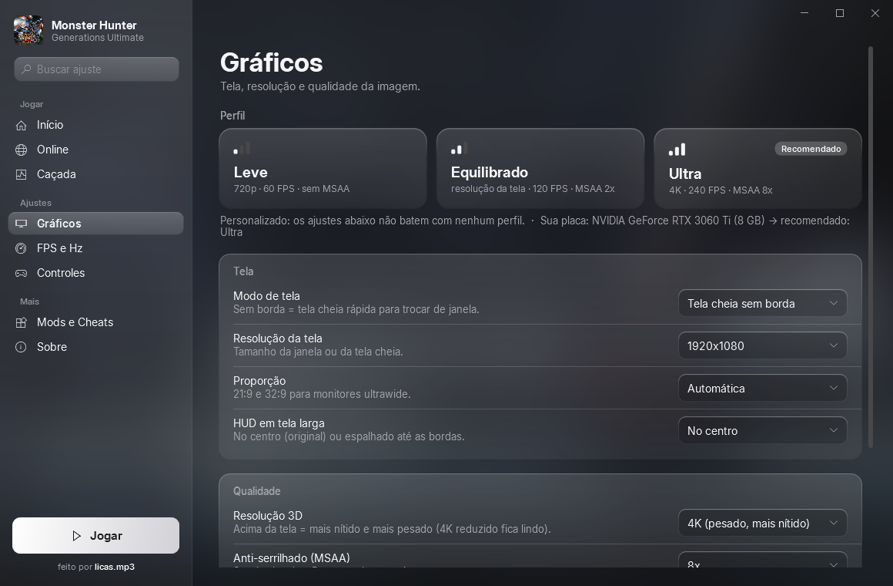
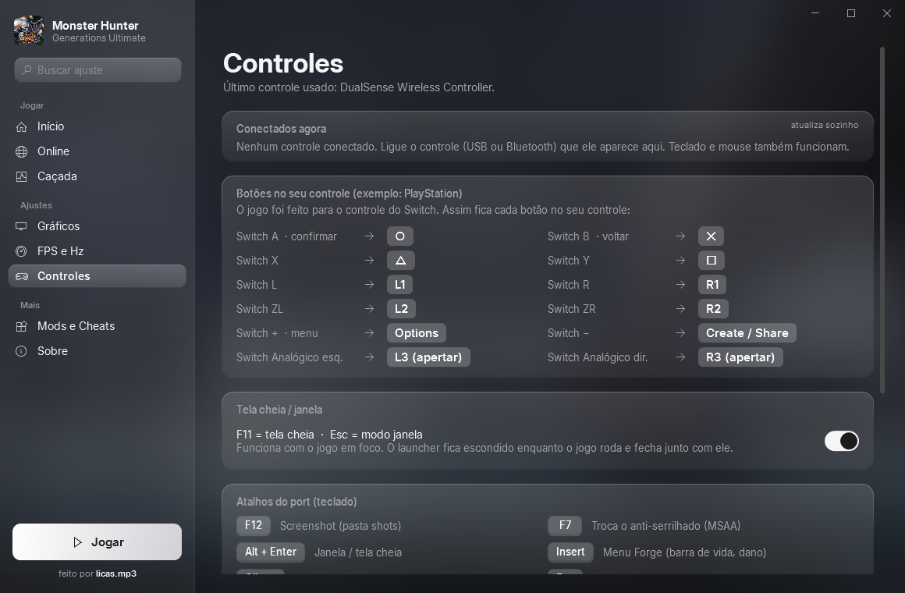
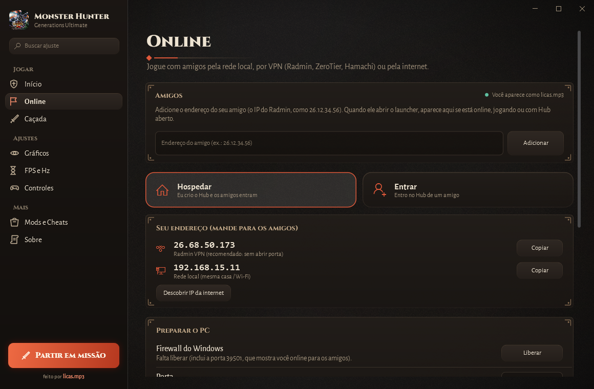
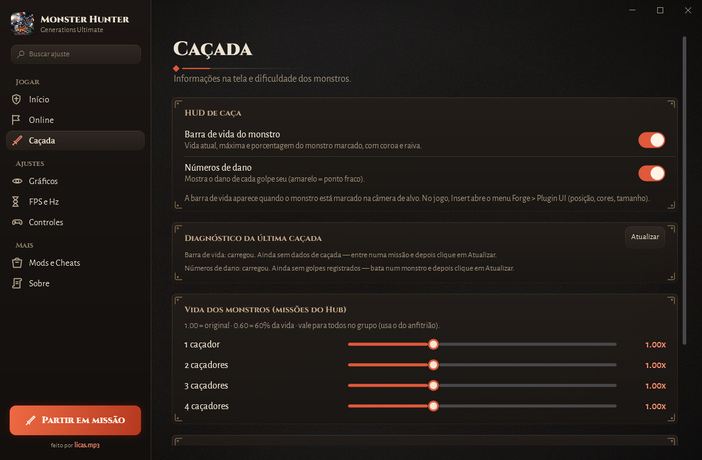
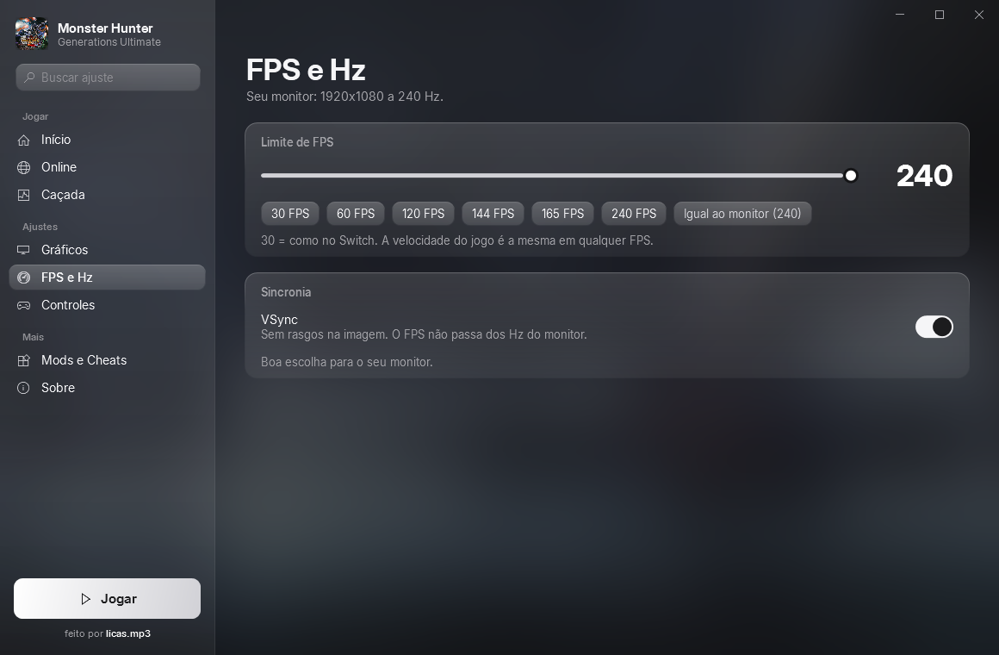
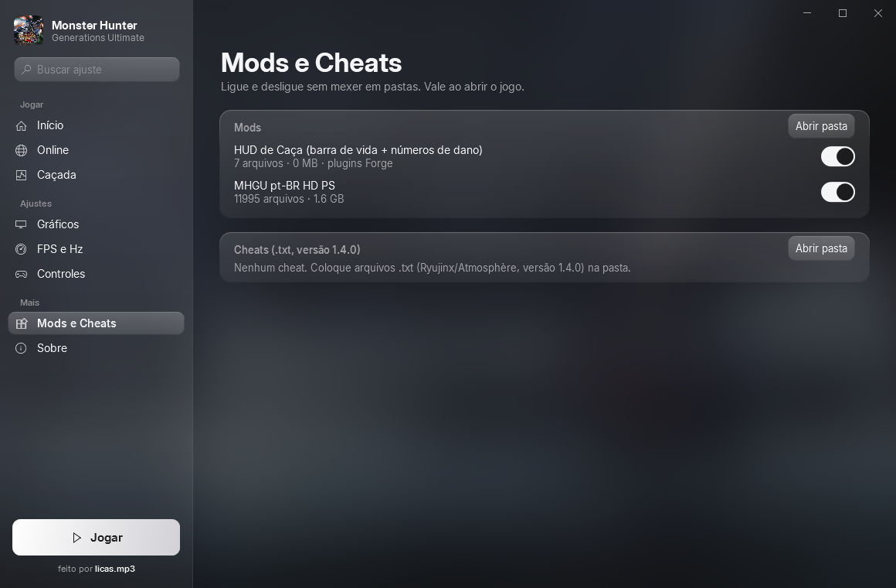

<div align="center">



<br>

[](../../releases/latest)
[](../../releases)


**Jogue Monster Hunter Generations Ultimate no PC, nativo, em português, com texturas HD e online com os amigos.**<br>
Um instalador que te guia passo a passo e um launcher que configura tudo sem você abrir uma pasta sequer.

[**⬇️ Baixar**](../../releases/latest) · [Como instalar](#-como-instalar) · [Recursos](#-recursos) · [Jogar online](#-jogar-online) · [Dúvidas](#-dúvidas)

</div>

---

<div align="center">
  
</div>

## ✨ Por que usar

| | |
|---|---|
| 🇧🇷 **Tudo em português** | Tradução completa do jogo: missões, diálogos, menus e tutoriais. Itens, armas e áreas ficam com o nome em inglês, para você achar fácil nas wikis. |
| 🖼️ **Visual em HD** | Texturas do MHGU HD Project, botões de PlayStation e até 4K com 240 FPS. |
| 🤝 **Online com amigos** | Hospede ou entre no Hub de um amigo por Radmin, ZeroTier, Hamachi, rede local ou internet. |
| 🩸 **HUD de caça** | Barra de vida do monstro e números de dano na tela. |
| 🎚️ **Perfis prontos** | Leve, Equilibrado ou Ultra com um clique, com o recomendado para a sua placa de vídeo. |
| 🔄 **Sempre atualizado** | O launcher avisa e se atualiza com um clique, e mantém o port na mesma versão para todo o grupo. |
| 🧭 **Sem complicação** | O instalador explica cada arquivo e confere se está certo antes de continuar. |

## 🆕 Launcher 3: Windows e Linux

O launcher foi refeito em **Electron** (pasta [`app/`](app)) para rodar igual no **Windows** e no **Linux** (Ubuntu, Arch...):

- **Windows:** `MHGU-Launcher-3.x.x-windows.exe` (portátil: coloque na pasta do `mhgurecomp.exe`)
- **Linux:** `MHGU-Launcher-3.x.x-linux.AppImage` ou `.deb` (aponte a pasta do port na primeira vez)

O port oficial roda no Windows e no Linux. O macOS ainda não é suportado pelo port, então o launcher de Mac fica para quando ele for.

## 📦 Como instalar

> [!IMPORTANT]
> O jogo **não vem junto**. Você precisa da **sua própria cópia** do Monster Hunter Generations Ultimate (Switch), na versão **1.4.0**.

1. Baixe o **`Novo MHGU.zip`** em [Releases](../../releases/latest) e extraia (botão direito → *Extrair tudo*).
2. Abra o **`Instalar MHGU.exe`** e siga as telas:
   - escolha a pasta onde instalar;
   - aponte o jogo base (**`.xci`**), o update 1.4.0 (**`.nsp`**) e o seu **`prod.keys`**.
     Usa Eden, yuzu ou Ryujinx? O botão **Achar sozinho** encontra o `prod.keys` para você.
   - já extraiu o jogo pelo emulador? Escolha a opção das pastas `exefs` e `romfs`.
3. Espere a instalação (uns 10 minutos) e abra pelo atalho **MHGU PC (pt-BR HD)** na área de trabalho.

> [!TIP]
> Já tem o port instalado? Baixe só o **`MHGU-Launcher.exe`** e coloque na pasta do `mhgurecomp.exe`.

### Requisitos

| | Mínimo |
|---|---|
| Sistema | Windows 10 ou 11, 64 bits |
| Processador | com AVX2 (Intel a partir da 4ª geração, AMD Ryzen) |
| Placa de vídeo | com Vulkan 1.2 |
| Espaço | ~30 GB livres durante a instalação |
| Internet | só para instalar, atualizar e jogar online |

## 🎮 Recursos

<table>
<tr>
<td width="50%" valign="top">

### 🖥️ Gráficos
Modo de tela, resolução, **resolução 3D até 4K**, MSAA até 8x, FXAA, ultrawide (21:9 e 32:9) e **campo de visão em graus** (70° a 120°).

</td>
<td width="50%"></td>
</tr>
<tr>
<td width="50%"></td>
<td width="50%" valign="top">

### 🕹️ Controles
Mostra os **controles conectados** na hora (DualSense, DualShock, Xbox, Pro Controller...) e **onde fica cada botão** no seu controle. **F11** = tela cheia, **Esc** = janela.

</td>
</tr>
<tr>
<td width="50%" valign="top">

### 🌐 Online
**Hospedar** ou **Entrar** com um clique. Mostra o seu IP do Radmin/ZeroTier para mandar aos amigos, libera o firewall, testa a conexão e guarda os amigos.

</td>
<td width="50%"></td>
</tr>
<tr>
<td width="50%"></td>
<td width="50%" valign="top">

### 🩸 Caçada
Liga e desliga a **barra de vida** e os **números de dano**, mostra o **diagnóstico da última caçada**, ajusta a **vida dos monstros** pelo número de caçadores e libera as **missões da Vila no Hub**.

</td>
</tr>
<tr>
<td width="50%" valign="top">

### ⚡ FPS e Hz
Limite de **30 a 240 FPS**, VSync e uma dica feita para o seu monitor.

</td>
<td width="50%"></td>
</tr>
<tr>
<td width="50%"></td>
<td width="50%" valign="top">

### 🧩 Mods e cheats
Liga e desliga mods e cheats sem mexer em pastas.

</td>
</tr>
</table>

**E também:** seus caçadores na tela inicial (nome, HR, horas e zenny), **importação do save** do Eden/yuzu/Ryujinx com backup automático, e as configurações salvas sozinhas.

## 🤝 Jogar online

1. Todo mundo instala pelo launcher e fica na **mesma versão** (o launcher mostra a sua na página **Online**).
2. Recomendado: instalem o [Radmin VPN](https://www.radmin-vpn.com/) e entrem na mesma rede. Assim ninguém precisa abrir porta no roteador.
3. **Quem hospeda**: launcher → **Online → Hospedar** → **Liberar** o firewall → mande o IP `26.x.x.x` para os amigos.
   No jogo: Hub → *Jogo Local* → *Criar Hub*.
4. **Quem entra**: launcher → **Online → Entrar** → cole o IP do amigo → **Testar**.
   No jogo: Hub → *Jogo Local* → *Procurar Hubs*.

> [!NOTE]
> No jogo original, cada jogador vê os **monstros pequenos** (Jaggi, Aptonoth...) num lugar diferente. O port sincroniza esses monstros, e este projeto corrigiu um erro em que um monstro pequeno morto pelo amigo continuava vivo para quem hospedava. Para funcionar, todos precisam da mesma versão.

## 🔄 Atualizações automáticas

Toda vez que abre, o launcher confere este repositório:

- **launcher novo** → aviso no Início e botão **Atualizar launcher**. Ele baixa, troca e reabre sozinho, mostrando as novidades.
- **port novo** → atualiza só os arquivos do port. Jogo, tradução, mods, saves e configurações ficam como estão.
- **correções do port** → consertos feitos aqui em cima do port oficial (veja [`port/`](port/LEIA-ME.md)), aplicados com um clique.

## ❓ Dúvidas

<details>
<summary><b>A barra de vida não aparece</b></summary>

A barra aparece quando o monstro está **marcado na câmera de alvo**. Se mesmo assim não aparecer, depois da caçada abra **Caçada → Diagnóstico da última caçada → Atualizar** e veja o que ele diz.
</details>

<details>
<summary><b>Meu amigo não consegue entrar no Hub</b></summary>

Confira: o Hub já foi criado no jogo? O firewall está **Liberado** na página Online? Vocês estão na mesma rede do Radmin? O **Testar** da página Online diz na hora se a conexão chega.
</details>

<details>
<summary><b>Como trago meu save do Switch ou do emulador?</b></summary>

Se você joga no Eden, yuzu ou Ryujinx, a tela inicial do launcher oferece **Importar save** (o save do PC vai para um backup antes). Do Switch: copie `system` e `system_backup` para `%APPDATA%\MHGURecomp\save\save_0\`.
</details>

<details>
<summary><b>Onde mudo som, música e brilho?</b></summary>

No menu **Opções** dentro do próprio jogo.
</details>

<details>
<summary><b>O instalador diz que o arquivo está errado</b></summary>

O jogo base precisa ser o **`.xci`** (o `.nsp` do jogo base não é aceito) e o update precisa ser o **1.4.0** do MHGU. Cada campo do instalador explica o que está faltando.
</details>

## 🗺️ Próximos passos

- [ ] Barra de vida e números de dano feitos dentro do port
- [ ] Qualidade de vida: coleta mais rápida, pular a espera do fim da missão e mais
- [ ] Distância de visão maior
- [x] Visual de guilda: quadro de missões, cartão de guilda, cenas animadas e perfis Leve / Equilibrado / Ultra
- [x] Online de verdade: amigos online, Hub aberto, ping e aviso de versão

## 🛠️ Para desenvolvedores

### Launcher 3 (Electron, Windows e Linux)

```bash
cd app
npm install
npm start            # abre o launcher
npm run windows      # dist/MHGU-Launcher-x.y.z-windows.exe
npm run linux        # dist/MHGU-Launcher-x.y.z-linux.AppImage e .deb
```

Publicar um Release (tag `v3.x.x`) monta o Windows e o Linux sozinho no GitHub Actions e anexa os arquivos nele.

### Launcher 2 (WPF, só Windows)

Não precisa instalar nada: o compilador C# já vem no Windows.

```bat
build.bat
```

Sai em `dist\`: `MHGU Launcher.exe` e `Instalar MHGU.exe`. Como publicar uma versão: [PUBLICAR.md](PUBLICAR.md). Correções do port: [port/LEIA-ME.md](port/LEIA-ME.md).

## 💛 Créditos

| | |
|---|---|
| **licas.mp3** | Tradução pt-BR, launcher, instalador e correções do port |
| [morerokk](https://github.com/morerokk/MHGURecomp) | Port de PC MHGURecomp |
| [Monkbreh](https://github.com/Monkbreh/MHGU-HD-Project) | Texturas HD (MHGU HD Project) |
| [Lawrence-al](https://github.com/Lawrence-al) | Barra de vida e números de dano (plugins Forge) |
| Fexty12573 | Forge |
| SciresM | hactool |
| [Natanael Gama](https://github.com/NDISCOVER/Cinzel-Typeface) e [Huerta Tipográfica](https://www.huertatipografica.com/) | Fontes Cinzel e Alegreya Sans (SIL Open Font License 1.1) |

<div align="center">
<sub>Monster Hunter Generations Ultimate © CAPCOM. Projeto de fãs, sem fins lucrativos e sem ligação com a CAPCOM.<br>
Nenhum arquivo do jogo, chave ou save é distribuído aqui: use a sua própria cópia.</sub>
</div>
