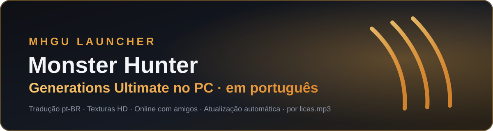
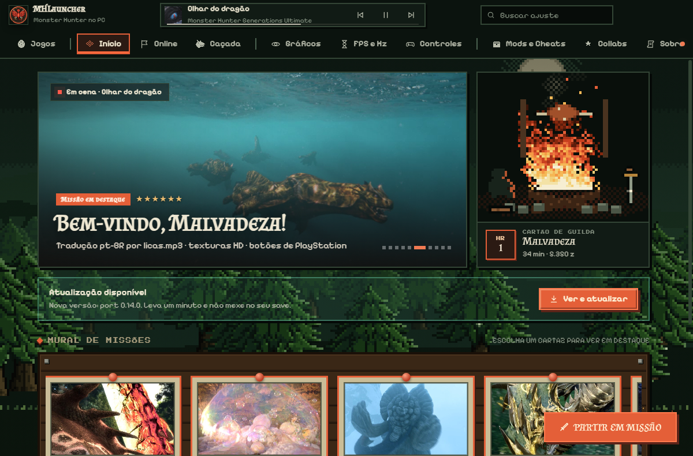
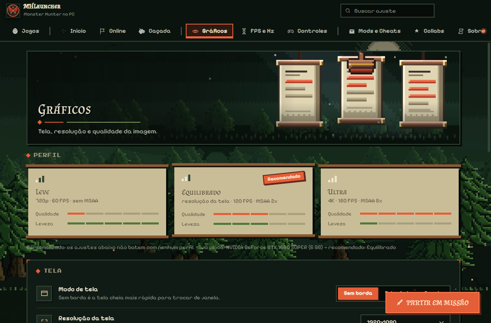
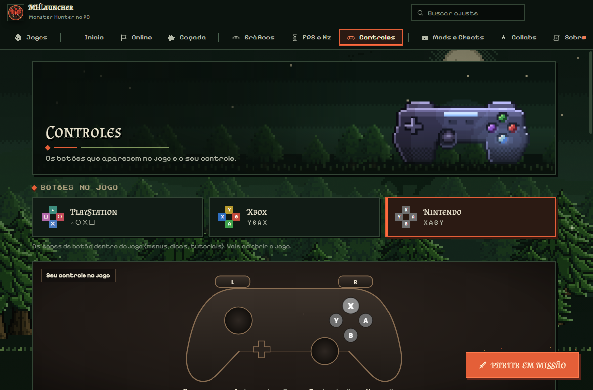
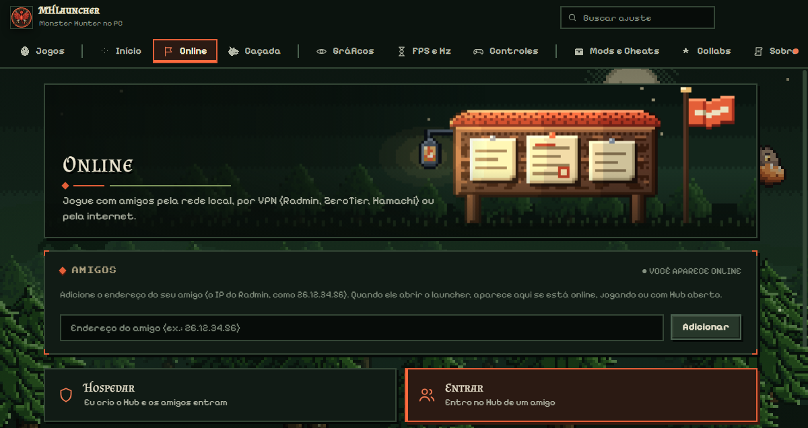
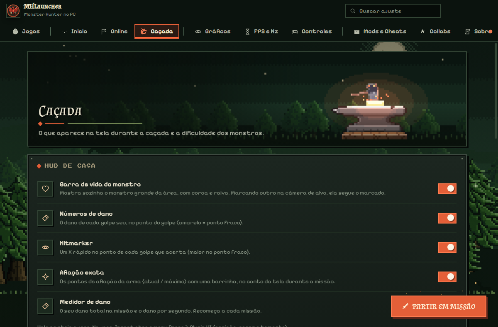
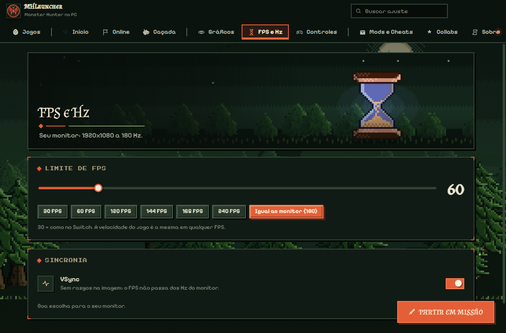
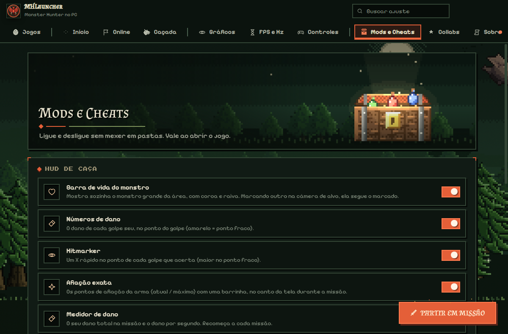
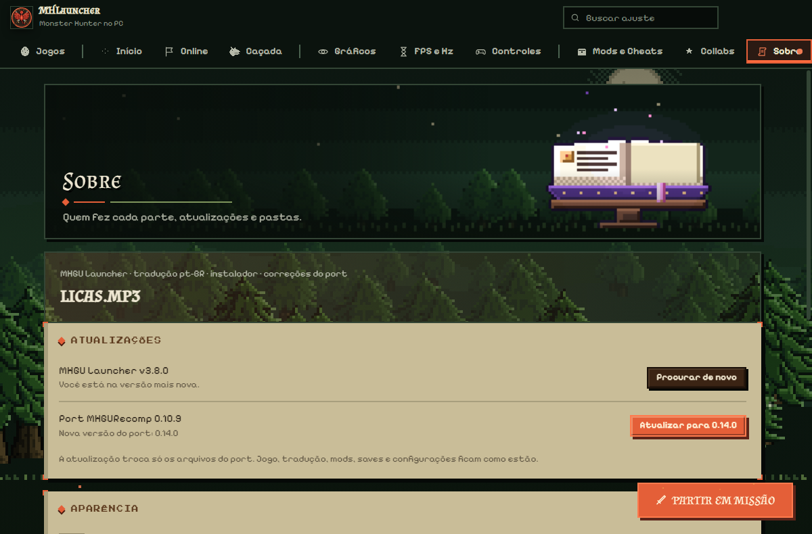

 

# MHLAUNCHER

**Os ports de Monster Hunter no PC num lugar só, em português.** 
O Generations Ultimate nativo, traduzido, com texturas HD e online com os amigos, e o 4 Ultimate e o Freedom Unite com um clique.

[**⬇️ Baixar**](../../releases/latest) · [**☕ Me paga um café**](https://mepagaumcafe.com.br/p/licasmp3/) · [Como instalar](#-como-instalar) · [Recursos](#-recursos) · [Jogar online](#-jogar-online) · [Dúvidas](#-dúvidas)

---

  

## 🐉 Biblioteca

| Jogo | Port | O que o MHLAUNCHER faz |
|---|---|---|
| **Generations Ultimate** (Switch) | [MHGURecomp](https://github.com/morerokk/MHGURecomp) | Instalador completo, tradução pt-BR, HD, HUD de caça, online e todos os ajustes |
| **4 Ultimate** (3DS) | [MH4UltimateDC](https://github.com/CompaLarios18/MH4UltimateDC) | Instala, atualiza e abre o port |
| **Freedom Unite** (PSP) | [MHForever](https://github.com/Mango77x/MHForever) | Instala, atualiza e abre o port |
| **Portable 3rd HD** (PSP/PS3) | [Yakumo](https://github.com/TeamGDB/Yakumo) | Instala, atualiza e abre o port; tradução pt-BR da comunidade a um clique |

Os ports são projetos de fãs, cada um com o seu autor e a sua licença. Nenhum jogo vem junto: cada um usa a própria cópia. O MHLAUNCHER avisa quando sai versão nova de qualquer um deles.

## ✨ Por que usar

| | |
|---|---|
| 🇧🇷 **Tudo em português** | Tradução completa do jogo: missões, diálogos, menus e tutoriais. Itens, armas e áreas ficam com o nome em inglês, para você achar fácil nas wikis. |
| 🖼️ **Visual em HD** | Texturas do MHGU HD Project, botões de PlayStation e até 4K com 240 FPS. |
| 🤝 **Online com amigos** | Hospede ou entre no Hub de um amigo por Radmin, ZeroTier, Hamachi, rede local ou internet. |
| 🩸 **HUD de caça** | Barra de vida do monstro e números de dano na tela. |
| 🎚️ **Perfis prontos** | Leve, Equilibrado ou Ultra com um clique, com o recomendado para a sua placa de vídeo. |
| 🔄 **Sempre atualizado** | O launcher avisa e se atualiza com um clique, e mantém o port na mesma versão para todo o grupo. |
| 🧭 **Sem complicação** | O instalador explica cada arquivo e confere se está certo antes de continuar. |

## 🆕 Launcher 3: Windows e Linux

O launcher foi refeito em **Electron** para rodar igual no **Windows** e no **Linux** (Ubuntu, Arch...):

- **Windows:** `MHLAUNCHER-3.x.x-windows.exe` (portátil: coloque na pasta do `mhgurecomp.exe`)
- **Linux:** `MHLAUNCHER-3.x.x-linux.AppImage` ou `.deb` (aponte a pasta do port na primeira vez). Por enquanto, os arquivos de Linux estão na [versão 3.8.0](../../releases/tag/v3.8.0); a 3.9.0 saiu só para Windows.

O port oficial roda no Windows e no Linux. O macOS ainda não é suportado pelo port, então o launcher de Mac fica para quando ele for.

## 📦 Como instalar

> [!IMPORTANT]
> O jogo **não vem junto**. Você precisa da **sua própria cópia** do Monster Hunter Generations Ultimate (Switch), na versão **1.4.0**.

1. Baixe o **`Novo-MHGU.zip`** em [Releases](../../releases/latest) e extraia (botão direito → *Extrair tudo*).
2. Abra o **`Instalar MHGU.exe`** e siga as telas:
   - escolha a pasta onde instalar;
   - aponte o jogo base (**`.xci`**), o update 1.4.0 (**`.nsp`**) e o seu **`prod.keys`**.
     Usa Eden, yuzu ou Ryujinx? O botão **Achar sozinho** encontra o `prod.keys` para você.
   - já extraiu o jogo pelo emulador? Escolha a opção das pastas `exefs` e `romfs`.
3. Espere a instalação (uns 10 minutos) e abra pelo atalho **MHGU PC (pt-BR HD)** na área de trabalho.

> [!TIP]
> Já tem o port instalado? Baixe só o **`MHLAUNCHER-3.x.x-windows.exe`** e coloque na pasta do `mhgurecomp.exe`.

### Requisitos

| | Mínimo |
|---|---|
| Sistema | Windows 10 ou 11, 64 bits, ou Linux 64 bits (Ubuntu, Arch...) |
| Processador | com AVX2 (Intel a partir da 4ª geração, AMD Ryzen) |
| Placa de vídeo | com Vulkan 1.2 |
| Espaço | ~30 GB livres durante a instalação |
| Internet | só para instalar, atualizar e jogar online |

## 🎮 Recursos

<table>
<tr>
<td width="50%" valign="top">

### 🖥️ Gráficos
Modo de tela, resolução, **resolução 3D até 4K**, MSAA até 8x, FXAA, ultrawide (21:9 e 32:9) e **campo de visão em graus** (70° a 120°).

</td>
<td width="50%"></td>
</tr>
<tr>
<td width="50%"></td>
<td width="50%" valign="top">

### 🕹️ Controles
Mostra os **controles conectados** na hora (DualSense, DualShock, Xbox, Pro Controller...) e **onde fica cada botão** no seu controle. **F11** = tela cheia, **Esc** = janela.

</td>
</tr>
<tr>
<td width="50%" valign="top">

### 🌐 Online
**Hospedar** ou **Entrar** com um clique. Mostra o seu IP do Radmin/ZeroTier para mandar aos amigos, libera o firewall, testa a conexão e guarda os amigos.

</td>
<td width="50%"></td>
</tr>
<tr>
<td width="50%"></td>
<td width="50%" valign="top">

### 🩸 Caçada
Liga e desliga a **barra de vida**, os **números de dano**, o **hitmarker**, a **afiação exata** da arma e o **medidor de dano** da missão, mostra o **diagnóstico da última caçada**, ajusta a **vida dos monstros** pelo número de caçadores e libera as **missões da Vila no Hub**.

</td>
</tr>
<tr>
<td width="50%" valign="top">

### ⚡ FPS e Hz
Limite de **30 a 240 FPS**, VSync e uma dica feita para o seu monitor.

</td>
<td width="50%"></td>
</tr>
<tr>
<td width="50%"></td>
<td width="50%" valign="top">

### 🧩 Mods e cheats
Liga e desliga mods e cheats sem mexer em pastas.

</td>
</tr>
<tr>
<td width="50%" valign="top">

### 📖 Sobre
A versão do launcher e do port com o botão de **atualizar**, as **pastas** do jogo, dos saves e das screenshots e o log do jogo a um clique, e os créditos de quem fez cada parte.

</td>
<td width="50%"></td>
</tr>
</table>

### 🎨 Visual em pixel art

O launcher inteiro é em pixel art, com direção de arte da Thainá. No fundo, uma floresta à noite com o pinheiro desenhado por ela: três fileiras iluminadas pela lua, neblina entre elas, vaga-lumes e, de vez em quando, um wyvern gorducho cruzando o céu. No alto de cada aba, uma cena animada com a sua própria luz: o quadro de missões com a lanterna, a bigorna e o martelo na brasa da forja, a ampulheta escoando, os pergaminhos ao luar, o controle com LEDs, o baú de mods e o livro do Sobre. Tudo anda em degraus, como jogo antigo.

**E também:** a aba **Collabs** com as missões de colaboração e onde achar cada uma, seus caçadores na tela inicial (nome, HR, horas e zenny), **importação do save** do Eden/yuzu/Ryujinx com backup automático, e as configurações salvas sozinhas.

## 🤝 Jogar online

1. Todo mundo instala pelo launcher e fica na **mesma versão** (o launcher mostra a sua na página **Online**).
2. Recomendado: instalem o [Radmin VPN](https://www.radmin-vpn.com/) e entrem na mesma rede. Assim ninguém precisa abrir porta no roteador.
3. **Quem hospeda**: launcher → **Online → Hospedar** → **Liberar** o firewall → mande o IP `26.x.x.x` para os amigos.
   No jogo: Hub → *Jogo Local* → *Criar Hub*.
4. **Quem entra**: launcher → **Online → Entrar** → cole o IP do amigo → **Testar**.
   No jogo: Hub → *Jogo Local* → *Procurar Hubs*.

> [!NOTE]
> No jogo original, cada jogador vê os **monstros pequenos** (Jaggi, Aptonoth...) num lugar diferente. O port sincroniza esses monstros, e este projeto corrigiu um erro em que um monstro pequeno morto pelo amigo continuava vivo para quem hospedava. Para funcionar, todos precisam da mesma versão.

## 🔄 Atualizações automáticas

Toda vez que abre, o launcher confere os Releases deste repositório:

- **launcher novo** → aviso no Início e botão **Atualizar launcher**. Ele baixa, troca e reabre sozinho, mostrando as novidades.
- **port novo** → atualiza só os arquivos do port. Jogo, tradução, mods, saves e configurações ficam como estão.
- **correções do port** → consertos feitos aqui em cima do port oficial , aplicados com um clique.

## ❓ Dúvidas

<b>A barra de vida não aparece</b>

A barra aparece quando o monstro está **marcado na câmera de alvo**. Se mesmo assim não aparecer, depois da caçada abra **Caçada → Diagnóstico da última caçada → Atualizar** e veja o que ele diz.

<b>Meu amigo não consegue entrar no Hub</b>

Confira: o Hub já foi criado no jogo? O firewall está **Liberado** na página Online? Vocês estão na mesma rede do Radmin? O **Testar** da página Online diz na hora se a conexão chega.

<b>Como trago meu save do Switch ou do emulador?</b>

Se você joga no Eden, yuzu ou Ryujinx, a tela inicial do launcher oferece **Importar save** (o save do PC vai para um backup antes). Do Switch: copie `system` e `system_backup` para `%APPDATA%\MHGURecomp\save\save_0\`.

<b>Onde mudo som, música e brilho?</b>

No menu **Opções** dentro do próprio jogo.

<b>O instalador diz que o arquivo está errado</b>

O jogo base precisa ser o **`.xci`** (o `.nsp` do jogo base não é aceito) e o update precisa ser o **1.4.0** do MHGU. Cada campo do instalador explica o que está faltando.

## 🗺️ Próximos passos

- [ ] Barra de vida e números de dano feitos dentro do port
- [ ] Qualidade de vida: coleta mais rápida, pular a espera do fim da missão e mais
- [ ] Distância de visão maior
- [x] Visual de guilda: quadro de missões, cartão de guilda, cenas animadas e perfis Leve / Equilibrado / Ultra
- [x] Online de verdade: amigos online, Hub aberto, ping e aviso de versão
- [x] Tema em pixel art: floresta animada ao fundo e uma cena com luz própria em cada aba

## 💬 Comunidade

- **Discord:** [discord.gg/WRmDhGs9uz](https://discord.gg/WRmDhGs9uz): ajuda na instalação, grupos de caça, builds, ideias pro launcher e avisos de versão nova.
- **Tradução pt-BR do MHGU** (também pra emulador, celular e Switch): [baixar no Google Drive](https://drive.google.com/file/d/1vzlwrwAhB6YdydBr9YBzHfrzPvEW_E2c/view?usp=share_link).

## ☕ Apoie o projeto

O MHLAUNCHER é e vai continuar **de graça**, sem anúncio e sem conta. Ele é feito por duas pessoas, no tempo livre.
Se ele te ajudou a voltar a caçar, você pode dar uma força:

Sem grana? Contar pros amigos, dar uma ⭐ aqui no GitHub e reportar bugs no Discord já ajuda muito.

## 📜 Licença

O MHLAUNCHER é **gratuito para baixar e usar**, mas **não é código aberto**: todos os direitos reservados. Não é permitido copiar, modificar, redistribuir em outros sites, vender ou usar o nome e a arte do MHLAUNCHER sem autorização. Detalhes em [LICENSE](LICENSE). Os ports, ferramentas e fontes de terceiros seguem as próprias licenças: veja [TERCEIROS.md](TERCEIROS.md).

## 💛 Créditos

### Criadores do MHLAUNCHER

<table>
<tr>
<td align="center" width="50%"><a href="https://github.com/licasmp4"> <b>licas.mp3</b></a> launcher, instalador, tradução pt-BR e correções do port</td>
<td align="center" width="50%"><a href="https://github.com/Ataenas"> <b>Thaina</b></a> cocriadora do projeto, arte em pixel e comunidade</td>
</tr>
</table>

### Os ports

O MHLAUNCHER instala e abre estes ports. Todo o mérito de rodar os jogos no PC é dos seus autores: passe lá e deixe uma ⭐.

| Jogo | Port | Autor |
|---|---|---|
| 🟠 Generations Ultimate | [MHGURecomp](https://github.com/morerokk/MHGURecomp) | [morerokk](https://github.com/morerokk) |
| 🔵 4 Ultimate | [MH4UltimateDC](https://github.com/CompaLarios18/MH4UltimateDC) | [CompaLarios18](https://github.com/CompaLarios18) |
| 🔴 Freedom Unite | [MHForever](https://github.com/Mango77x/MHForever) | [Mango77x](https://github.com/Mango77x) |
| 🟢 Portable 3rd HD | [Yakumo](https://github.com/TeamGDB/Yakumo) | [TeamGDB](https://github.com/TeamGDB) |

### Também usamos

| | |
|---|---|
| [Monkbreh](https://github.com/Monkbreh/MHGU-HD-Project) | Texturas HD (MHGU HD Project) |
| [Lawrence-al](https://github.com/Lawrence-al) | Barra de vida e números de dano (plugins Forge) |
| Fexty12573 | Forge |
| SciresM | hactool |
| [Natanael Gama](https://github.com/NDISCOVER/Cinzel-Typeface) e [Huerta Tipográfica](https://www.huertatipografica.com/) | Fontes Cinzel e Alegreya Sans (SIL Open Font License 1.1) |
| Ana Sanfelippo, [Pixelify Sans Project Authors](https://github.com/eifetx/Pixelify-Sans) e Press Start 2P Project Authors | Fontes Almendra SC, Pixelify Sans e Press Start 2P do tema pixel (SIL Open Font License 1.1) |

Licenças de cada um em [TERCEIROS.md](TERCEIROS.md).

Monster Hunter Generations Ultimate © CAPCOM. Projeto de fãs, sem fins lucrativos e sem ligação com a CAPCOM. 
Nenhum arquivo do jogo, chave ou save é distribuído aqui: use a sua própria cópia.

